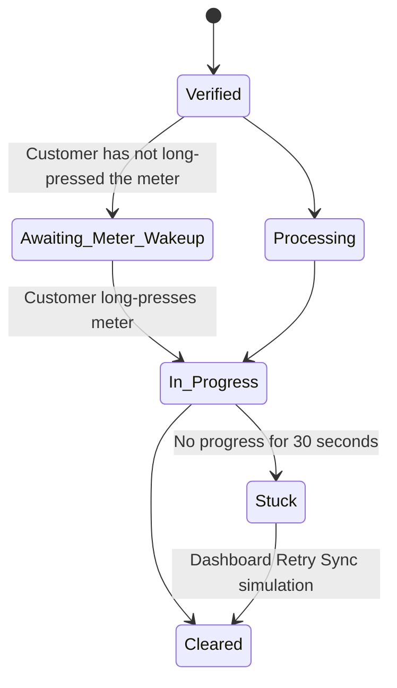
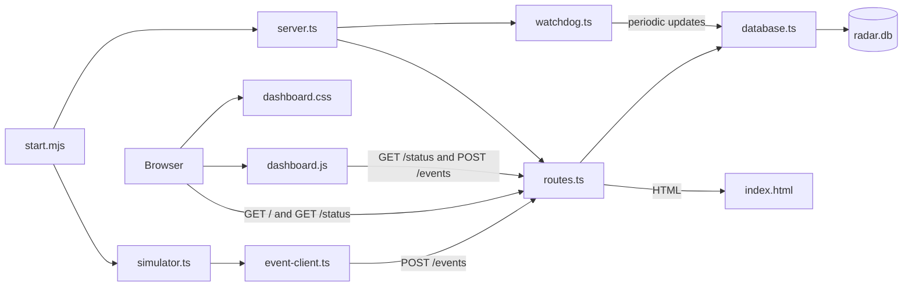
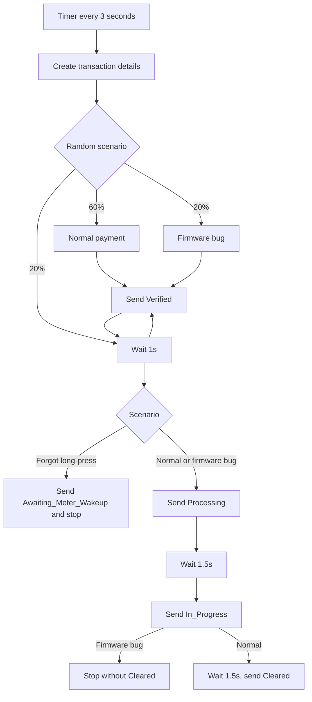
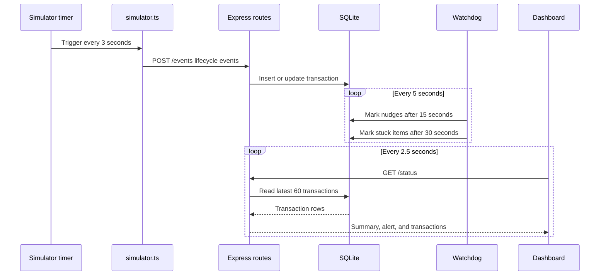

# Zero-Wait Payment Radar

Zero-Wait Payment Radar is a local payment and meter-synchronization watchdog demo. It accepts payment lifecycle events, stores them in SQLite, detects delayed transactions, and presents recent activity in an operations dashboard.

The project deliberately separates the server, database access, routes, watchdog, simulator, and dashboard assets. This keeps each responsibility small and makes the application easier to extend without changing unrelated behavior.

## What the demo models

A payment moves through stages before the meter receives credit:



The watchdog distinguishes between:

- **Customer delay:** `Awaiting_Meter_Wakeup` can trigger an SMS nudge after 15 seconds, but is not treated as a system failure.
- **System delay:** another non-cleared status is flagged as stuck after 30 seconds.

These are synthetic demo actions. No real payment provider, SMS service, or physical meter is contacted.

## Requirements

- Node.js 22.13 or later, because the server uses the built-in `node:sqlite` module.
- npm.

## Run locally

Install dependencies:

```sh
npm install
```

Start the server and simulator together:

```sh
node start.mjs
```

Open [http://localhost:3000](http://localhost:3000).

To run the processes separately instead, open two terminals:

```sh
npx tsx server.ts
```

```sh
npx tsx simulator.ts
```

Stop a process with `Ctrl+C`.

The server creates `radar.db` in the current working directory and clears all transaction rows on startup, so each run begins with an empty dashboard. The simulator submits one synthetic payment every three seconds. The combined starter forwards output from both processes and stops both when `Ctrl+C` is pressed.

## Project structure

```text
.
|-- server.ts                  # Application startup
|-- start.mjs                  # Starts the server and simulator together
|-- server/
|   |-- database.ts            # SQLite schema and data operations
|   |-- routes.ts              # HTTP endpoints and incident diagnosis
|   `-- watchdog.ts            # Delayed-transaction monitoring
|-- simulator.ts               # Payment scenario orchestration
|-- simulator/
|   |-- config.ts              # Regions and payment amounts
|   |-- event-client.ts        # HTTP delivery to POST /events
|   `-- random.ts              # Random selection helper
|-- index.html                 # Dashboard structure
|-- public/
|   |-- dashboard.css          # Dashboard presentation
|   `-- dashboard.js           # Dashboard behavior and API calls
|-- radar.db                   # Runtime SQLite database
`-- tsconfig.json              # TypeScript configuration
```



## Combined starter: `start.mjs`

The starter is a small Node.js process coordinator. It uses Node's built-in `spawn` function to run the existing `server.ts` and `simulator.ts` commands with their output attached to the current terminal.

It does not duplicate application behavior:

- The server remains responsible for HTTP handling, database access, and the watchdog.
- The simulator remains responsible for creating sample payment scenarios.
- `start.mjs` only launches, monitors, and stops both child processes.

If either child process exits, the starter stops the other process. When the user presses `Ctrl+C`, the starter terminates each complete process tree. This prevents hidden `tsx` children from leaving the simulator or server running on its own.

## Server startup: `server.ts`

`server.ts` is intentionally small. It is the composition entry point rather than the place for business logic.

### Imports

- `express` creates the HTTP application and supplies middleware and routing.
- `registerRoutes` comes from `server/routes.ts` so endpoint definitions remain outside startup code.
- `startWatchdog` comes from `server/watchdog.ts` so background monitoring starts independently of request handlers.

### Startup stages

1. **Create the app:** `express()` creates the server instance.
2. **Parse JSON:** `express.json()` makes `POST /events` request bodies available as `req.body`.
3. **Serve dashboard assets:** `express.static('public')` exposes `dashboard.css` and `dashboard.js`.
4. **Register routes:** `registerRoutes(app)` installs the page and API endpoints.
5. **Start monitoring:** `startWatchdog()` begins the five-second watchdog loop.
6. **Listen:** the server starts on port `3000`.

Each stage remains separate so adding middleware, routes, or background jobs does not require mixing their implementations.

## Database module: `server/database.ts`

This module owns the SQLite connection, schema, queries, and transaction updates. Routes and the watchdog call its functions rather than embedding SQL.

### Imports

- `DatabaseSync` from Node's `node:sqlite` module provides the synchronous SQLite connection.

### Types

- `TransactionEvent` describes an incoming event. The transaction ID and status are required; the other payment details are optional because dashboard retry and long-press actions only send an ID and status.
- `Transaction` describes a stored transaction, including timestamps and the watchdog flags.

### Module initialization

The module opens `radar.db` and runs `CREATE TABLE IF NOT EXISTS transactions`. This makes startup repeatable: an existing database is preserved, while a missing database and table are created automatically.

### Functions

#### `clearTransactions()`

Deletes all stored transaction rows before the server starts accepting requests. The database file and schema remain in place, but the dashboard starts each run without data from an earlier run.

#### `recordEvent(event, now)`

Inserts a new transaction or updates an existing one with the same `transaction_id`.

For new records:

- Missing `customer_ref` becomes `UNKNOWN`.
- Missing `region` becomes `Nairobi`.
- Missing firmware becomes `v2.4.1`.
- Missing amount becomes `0`.
- `created_at` and `updated_at` receive the supplied timestamp.

For existing records:

- The status and `updated_at` are changed.
- `is_stuck` is cleared when status becomes `Cleared`.
- `needs_nudge` is preserved only while the status remains `Awaiting_Meter_Wakeup`.

#### `getRecentTransactions()`

Returns the 60 newest records, ordered by creation time descending. The limit keeps the dashboard response and table bounded as the database grows.

#### `markAwaitingTransactionsForNudge(now)`

Sets `needs_nudge = 1` for sleeping meters that are older than the supplied cutoff and have not already been nudged.

The function receives a timestamp rather than calculating the threshold itself. This keeps database work focused and leaves timing policy in the watchdog.

#### `markStuckTransactions(now)`

Sets `is_stuck = 1` for old transactions that are neither `Cleared` nor `Awaiting_Meter_Wakeup` and have not already been marked.

This separation prevents an expected customer action from being classified as a system failure.

## Routes module: `server/routes.ts`

This module owns HTTP behavior and dashboard response construction.

### Imports

- `Express` is imported as a type to describe the server instance without adding runtime code.
- Node's `path` module resolves the dashboard file path.
- `getRecentTransactions` and `recordEvent` provide the required database operations.
- `TransactionEvent` is imported as a type to describe incoming event payloads.

### `registerRoutes(app)`

This function installs all current endpoints on the Express application.

#### `GET /`

Serves `index.html` from the project root.

#### `POST /events`

1. Reads the JSON body as a transaction event.
2. Requires `transaction_id` and `status`.
3. Returns HTTP 400 when either required field is missing.
4. Passes valid data to `recordEvent`.
5. Returns the saved transaction ID and status.

#### `GET /status`

1. Loads up to 60 recent transactions.
2. Counts cleared, awaiting-wakeup, and stuck records. The browser derives the active count.
3. Builds an incident alert when at least three transactions are stuck.
4. Returns summary data and full transaction rows.

Incident diagnosis uses the dominant concentration:

1. If at least 70% share one firmware version, it reports a firmware anomaly.
2. Otherwise, if at least 70% share one region, it reports a possible regional network problem.
3. Otherwise, it reports a general system incident.

The route currently contains this diagnosis intentionally as one concern. It can later be extracted if tests or additional diagnosis rules make that useful.

## Watchdog module: `server/watchdog.ts`

The watchdog identifies delays without tying timer logic to route handling or server startup.

### Imports

- `markAwaitingTransactionsForNudge` flags transactions waiting for a customer action.
- `markStuckTransactions` flags transactions that are likely stalled in the system.

### `startWatchdog()`

Runs every five seconds:

1. It captures the current time.
2. It finds transactions that have awaited a meter wakeup for more than 15 seconds and logs each new nudge batch.
3. It finds other unfinished transactions older than 30 seconds and logs each new stuck batch.

The log represents a queued SMS or alert in this demo; no external notification is sent.

## Simulator

The simulator exercises the complete event pipeline without requiring a real payment system.



### `simulator.ts`

#### Imports

- `AMOUNTS` and `REGIONS` supply configurable input values.
- `sendEvent` delivers events to the server.
- `randomItem` selects a random region and amount.

#### `sleep(ms)`

Returns a promise that resolves after the requested delay. `simulateSinglePayment` uses it to model asynchronous payment and meter-processing time.

#### `simulateSinglePayment(idNum)`

Creates one synthetic transaction and sends its lifecycle events:

1. Build a transaction ID and meter reference.
2. Choose a region and amount.
3. Choose a scenario:
   - 60% normal.
   - 20% customer forgot the long-press.
   - 20% firmware bug.
4. Send `Verified` and wait one second.
5. For the forgotten long-press scenario, send `Awaiting_Meter_Wakeup` and stop.
6. Otherwise, send `Processing`, wait 1.5 seconds, and send `In_Progress`.
7. For the firmware bug scenario, stop without clearing the transaction.
8. For a normal payment, wait another 1.5 seconds and send `Cleared`.

An interval at the end of the file starts another simulation every three seconds.

### `simulator/config.ts`

Exports:

- `REGIONS`: the five regions used for generated transactions.
- `AMOUNTS`: the six allowed payment amounts.

Keeping data separate makes it possible to expand or change demo inputs without editing simulation logic.

### `simulator/event-client.ts`

Defines the simulator's transport boundary.

#### `sendEvent(payload)`

Sends one JSON event to `http://localhost:3000/events` with a `POST` request. If the fetch fails, it logs a clear hint that the watchdog server may not be running.

The event client intentionally does not contain scenario logic, so it can later be replaced or reused without rewriting the simulator.

### `simulator/random.ts`

#### `randomItem(arr)`

Returns one random array item. The generic type parameter preserves the type of the item returned to the caller, while the non-null assertion is appropriate for this application's non-empty configuration arrays.

## Dashboard

### `index.html`

Defines the page structure, summary cards, transaction table, alert banner, stylesheet link, and JavaScript link. It contains no business logic.

### `public/dashboard.css`

Contains the visual rules for the layout, cards, table, status badges, buttons, colors, and alert banner. Keeping styles separate lets the UI design evolve without mixing CSS into application markup.

### `public/dashboard.js`

#### `refreshDashboard()`

- Fetches `GET /status`.
- Separates cleared, stuck, awaiting-wakeup, and active transactions.
- Updates the summary cards and incident banner.
- Sorts the table by operational priority: stuck, awaiting long-press, active, then cleared.
- Renders status labels and available actions.
- Saves the latest stuck records for CSV export.

It runs once at page load and then every 2.5 seconds.

#### `clearTxn(transaction_id)`

Posts a `Cleared` status for the selected transaction and refreshes the dashboard. This is a simulation of retrying synchronization, not a real meter retry.

#### `simulateLongPress(transaction_id)`

Posts `In_Progress`, refreshes the dashboard, and posts `Cleared` after 1.5 seconds. This models a customer pressing the physical meter.

#### `exportStuckCSV()`

Exports the latest stuck transactions to a CSV download. It displays an alert instead when there are no system failures to export.

## API reference

### `POST /events`

Creates a transaction or updates the status of an existing transaction.

Required:

- `transaction_id`
- `status`

Optional:

- `customer_ref`
- `region`
- `firmware_version`
- `amount`

Example:

```sh
curl -X POST http://localhost:3000/events \
  -H 'Content-Type: application/json' \
  -d '{
    "transaction_id": "MPESA-1001",
    "customer_ref": "MTR-12345",
    "region": "Embakasi",
    "firmware_version": "v2.4.1",
    "amount": 100,
    "status": "Verified"
  }'
```

Success response:

```json
{
  "ok": true,
  "transaction_id": "MPESA-1001",
  "status": "Verified"
}
```

### `GET /status`

Returns:

- `summary.total_recent`
- `summary.cleared`
- `summary.awaiting_wakeup`
- `summary.stuck`
- `incident_alert`
- Up to 60 recent transactions

Example:

```sh
curl http://localhost:3000/status
```

## End-to-end processing flow



## Operational notes

- The simulator uses synthetic data and does not connect to an actual payment provider or meter.
- Dashboard actions demonstrate expected state transitions; they do not retry or control real hardware.
- `radar.db` is runtime state and is excluded from version control.
- The watchdog only logs notification and alert actions.
- The `GET /status` result is limited to 60 records.
- `package.json` currently has no automated test command. Type-check the code with:

```sh
npx tsc --noEmit
```
